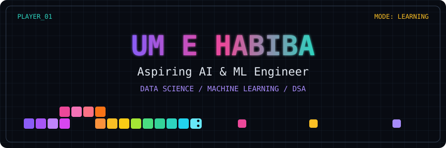
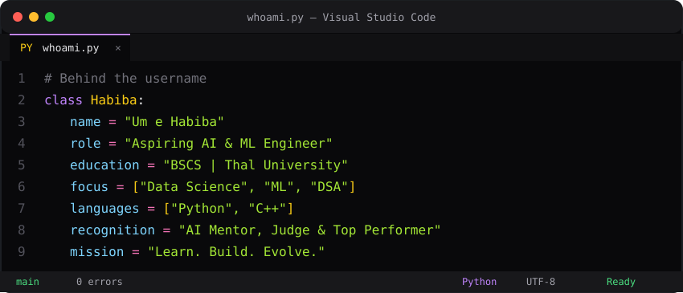
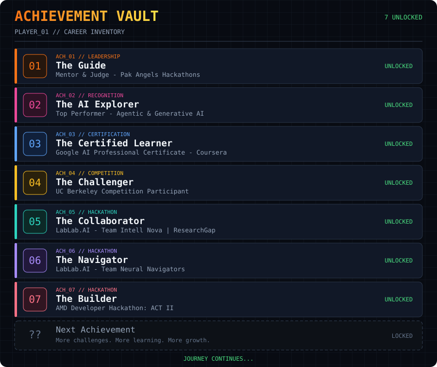

<!-- ==================== SNAKE GAME HEADER ==================== -->

  

 

  

  

<i>Every challenge is another level to unlock.</i>

---

<!-- ==================== DEVELOPER IDENTITY ==================== -->

## 💻 Behind the Username

  

---

<!-- ==================== ACHIEVEMENT VAULT ==================== -->

## 🏆 Achievement Vault

  

### 🔐 Credential Inventory

  

<i>Achievements are checkpoints, not the destination.</i>

---

<!-- ==================== TECHNICAL TOOLKIT ==================== -->

## ⚡ Developer Toolkit

  

### Programming Languages

### Data Science & Machine Learning

 

### Development Environment

  

---

<!-- ==================== GITHUB JOURNEY ==================== -->

## 📊 Developer Dashboard

  

  

 

  

---

<!-- ==================== CONTRIBUTION ACTIVITY ==================== -->

## 📈 Consistency in Code

 

### Contribution Heatmap

  

<i>Small contributions. Meaningful progress.</i>

---

<!-- ==================== LEETCODE STATISTICS ==================== -->

## 🧩 Thinking in Algorithms

  

  

<i>One problem at a time. One better solution at a time.</i>

---

<!-- ==================== RESEARCH INTERESTS ==================== -->

## 🔬 Beyond the Code

 

 

---

<!-- ==================== GAME STYLE FOOTER ==================== -->

## 🎮 The Game Continues...

 

  

**Understanding before implementation.**  
**Consistency before perfection.**

 

<i>A journey measured not just in commits, but in understanding.</i>

  

<!-- ==================== END OF PROFILE ==================== -->
